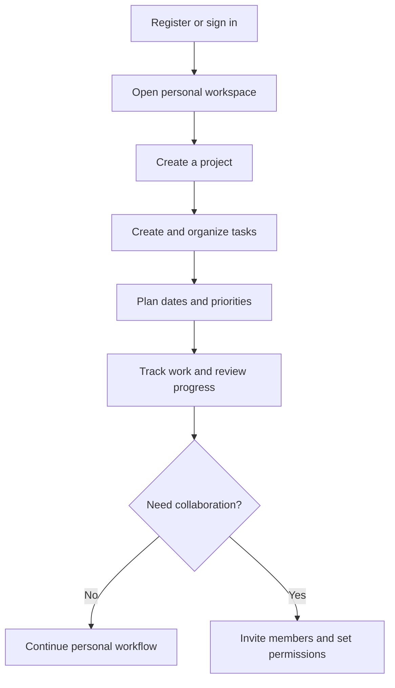
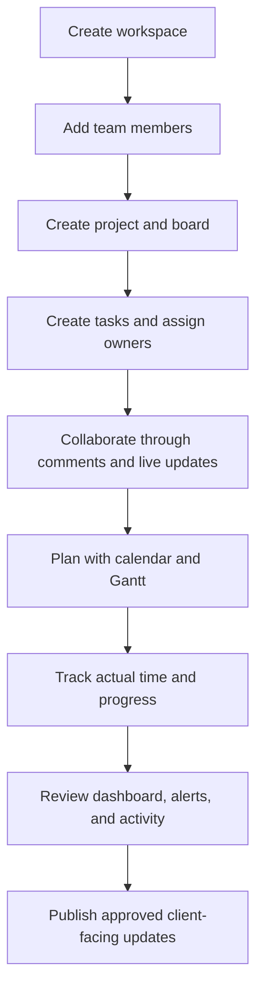
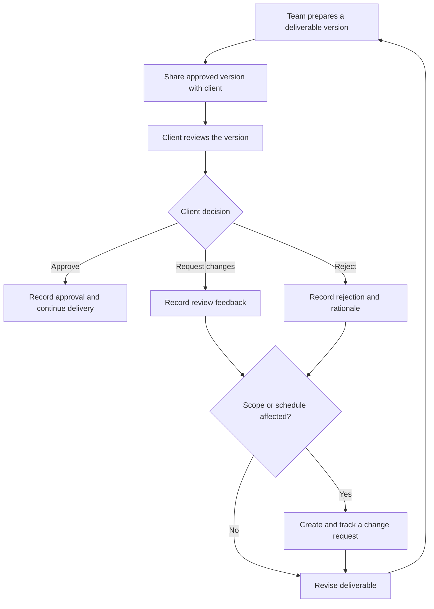
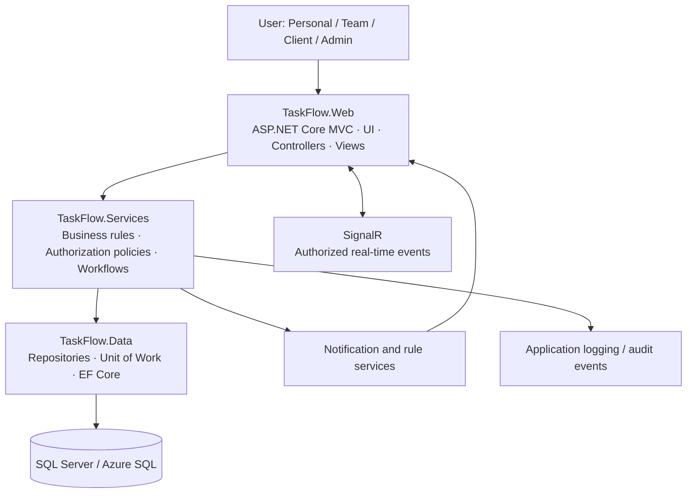

<!--
TaskFlow — GitHub README
This README describes the agreed project scope and intended design.
Update feature status, setup commands, links, and test results as the implementation evolves.
-->

<div align="center">

# TaskFlow
### Plan clearly. Work together. Deliver with confidence.

**A personal and collaborative project management platform built with ASP.NET Core**

[](#)
[](#architecture)
[](#detailed-features)
[](#project-principles)
[](#project-timeline)

*A unified workspace for planning projects, managing tasks, visualizing schedules, tracking time, collaborating live, and sharing approved progress with clients.*

</div>

---

## Table of Contents

- [Overview](#overview)
- [The Problem](#the-problem)
- [Our Solution](#our-solution)
- [Project Principles](#project-principles)
- [Target Users](#target-users)
- [Feature Map](#feature-map)
- [Detailed Features](#detailed-features)
- [User Roles and Access](#user-roles-and-access)
- [Key Workflows](#key-workflows)
- [Architecture](#architecture)
- [Technology Stack](#technology-stack)
- [Design Patterns](#design-patterns)
- [High-Level Data Model](#high-level-data-model)
- [Security and Privacy](#security-and-privacy)
- [Non-Functional Requirements](#non-functional-requirements)
- [UI and Design System](#ui-and-design-system)
- [Project Structure](#project-structure)
- [Development Setup](#development-setup)
- [Testing Strategy](#testing-strategy)
- [Deployment Direction](#deployment-direction)
- [Team and Responsibilities](#team-and-responsibilities)
- [Project Timeline](#project-timeline)
- [Definition of Done](#definition-of-done)
- [Current Status and Scope Notes](#current-status-and-scope-notes)
- [Contributing](#contributing)
- [License](#license)

---

## Overview

**TaskFlow** is a web-based project and task management system inspired by the collaborative workflow capabilities commonly found in tools such as Trello and Jira. It helps users structure work, coordinate with teammates, understand project progress, and keep client-facing delivery information organized in one place.

TaskFlow supports both **individual productivity** and **team collaboration**. A person can start with a private workspace, create projects and tasks, and use personal planning tools without inviting a team. As work grows, the user can collaborate through workspaces, teams, roles, shared boards, real-time updates, reporting, and a controlled client portal.

The solution combines visual task management, schedule planning, time tracking, collaboration, rule-based automation, and client delivery workflows in one system.

> **Project scope:** TaskFlow is a conventional software application. **AI is explicitly out of scope.** Automation and project-health alerts are based on transparent, predefined rules and stored data—not AI models or generated predictions.

## The Problem

Teams and independent professionals often manage project information across separate boards, calendars, spreadsheets, chats, documents, and time trackers. This can lead to:

- Work items being scattered across several tools.
- Unclear ownership, priority, due dates, or task status.
- Poor visibility into dependencies, workload, and delivery risk.
- Gaps between estimated effort and actual time spent.
- Slow handovers and lost decisions in discussions.
- Clients receiving inconsistent updates or seeing information they should not access.
- Repeated manual work for reminders, routine status changes, and progress reporting.

## Our Solution

TaskFlow brings these workflows together through:

- **Kanban boards** for day-to-day execution and clear task status.
- **Gantt charts and calendars** for schedules, dependencies, milestones, and deadlines.
- **Time tracking and timesheets** for recording effort and comparing estimates with actuals.
- **Dashboards and reports** for project progress, overdue work, workload, and time summaries.
- **Real-time collaboration** for timely board updates and shared project discussions.
- **Rule-based automations and health alerts** for predictable, explainable actions.
- **A client portal** for carefully controlled progress sharing, deliverable reviews, and change requests.
- **Personal productivity tools** for users who want to organize work before involving a team.

## Project Principles

| Principle | What it means in TaskFlow |
|---|---|
| **No AI** | No AI assistant, LLM, AI-generated recommendations, or AI-based prediction is part of the project scope. |
| **Personal first** | Users can register and start in a personal workspace without creating a team or inviting others. |
| **Collaboration by design** | Workspaces, permissions, comments, notifications, and real-time updates support shared work. |
| **Privacy by default** | Workspace data and internal team content are protected by server-side access checks. |
| **Client visibility is controlled** | Client-facing progress, deliverables, and review decisions are separated from internal-only information. |
| **Transparent automation** | Automated actions use understandable conditions and rules that can be reviewed and tested. |
| **Maintainable architecture** | Presentation, business logic, and data access are separated into defined layers. |
| **Measurable quality** | Requirements include verification methods; proposed targets are not presented as achieved results. |

## Target Users

- **Individuals and students** who want a personal dashboard, task lists, priorities, and deadlines.
- **Freelancers** managing multiple projects, delivery dates, time records, and client feedback.
- **Small teams** coordinating tasks, discussions, schedules, and shared files.
- **Project managers and team leads** tracking progress, workload, dependencies, and potential delays.
- **Clients** who need a safe, focused view of approved progress and deliverables without access to internal team content.
- **Administrators** responsible for users, roles, workspace policies, system settings, and operational visibility.

## Feature Map

The following table describes the **intended project scope**. Feature completion must be updated against the implementation and test evidence as development progresses.

| Area | Main capabilities | Primary owner |
|---|---|---|
| Authentication and personal productivity | Registration, sign-in, private workspace, personal dashboard, My Day, My Work, quick capture, global search, saved views, notification preferences | Mostafa |
| Workspace and project management | Workspaces, teams, invitations, members, roles, project settings, access control, reusable project templates | Ahmed |
| Task management and collaboration | Kanban, task lifecycle, subtasks, labels, comments, attachments, task history, handover notes | Alaa |
| Planning and time management | Calendar, Gantt, dependencies, milestones, timer, time entries, timesheets, reports, rule-based health alerts | Ahd |
| Client delivery | Client access, Client Portal, Project Live Room, approved progress sharing, deliverables, versions, reviews, change requests | Eman |
| Shared platform services | Identity integration, authorization conventions, notifications/real-time contracts, architecture, integration, repository workflow, deployment coordination | Mostafa coordinates; all members contribute |
| Public marketing pages | Landing page, Features/How It Works, Pricing, and optional Contact/FAQ pages | Mostafa; managed separately from internal module allocation |

## Detailed Features

### 1. Authentication and Personal Productivity

Designed to help a user organize work independently before joining a team.

- Account registration, sign-in, sign-out, and account management using ASP.NET Identity.
- Private personal workspace created or made available during onboarding.
- Personal dashboard showing relevant work at a glance.
- **My Day** view for tasks requiring attention today.
- **My Work** view for tasks assigned to the signed-in user across authorized projects.
- **Quick Capture** to record a task or idea before fully organizing it.
- Global search across permitted projects and tasks.
- Saved filters/views for frequently used combinations of status, priority, assignee, date, and labels.
- Central in-app notification center and notification preferences.
- Keyboard-friendly navigation and responsive layouts.

### 2. Workspaces, Teams, and Projects

- Create and manage workspaces and teams.
- Invite members and assign appropriate access levels.
- Define workspace and project membership and permissions.
- Create projects within a workspace.
- Configure project details and settings.
- Create or customize boards and board columns, for example `To Do`, `In Progress`, `Review`, and `Done`.
- Start from reusable project templates, with initial examples such as **Agile**, **Scrum**, and **Basic**.
- Archive and restore projects where supported by the final implementation.
- Keep membership and project data isolated between workspaces.

### 3. Tasks and Kanban Boards

#### Task information

A task may include:

- Title and description, with rich-text support where implemented.
- Status, priority, due date, and estimated effort.
- One or more assignees, according to the agreed project rules.
- Labels and color tags.
- Subtasks or checklist items with completion tracking.
- Optional custom fields and reusable task templates.
- Comments, mentions, attachments, and a record of important changes.

#### Task operations

- Create, view, edit, delete, archive, copy, or move tasks as authorized.
- Move tasks between Kanban columns using drag and drop.
- Configure work-in-progress (WIP) limits where included.
- Use swimlanes or additional visual grouping where included.
- Filter tasks by status, priority, assignee, date, label, and other supported fields.
- Track overdue tasks and review task progress through the board.
- Apply task-state rules so status transitions follow the agreed workflow.

### 4. Team Collaboration

- Real-time board and task updates through SignalR.
- Task-level comment threads and discussion history.
- File attachments with upload validation and authorized downloads.
- Member mentions where implemented, linked to the notification system.
- Current-viewer presence indicators where feasible.
- Consistent server-side handling of simultaneous edits and conflicting changes.
- Activity history showing who performed an auditable action and when.
- **Task Handover Notes** to document context, remaining work, decisions, blockers, and next steps when work changes hands.

### 5. Scheduling and Project Planning

- Calendar views for deadlines and scheduled work.
- Gantt chart visualization for project timelines.
- Task dependencies, including a planned finish-to-start relationship.
- Date and duration adjustments from the timeline where supported.
- Milestone markers for significant project events.
- Critical-path highlighting if the dependency model and schedule logic support it.
- Visible overdue work and key deadlines.
- Planning information that can be compared with task status and reported progress.

### 6. Time Tracking and Timesheets

- Start and stop a timer for active task work.
- Record time entries against the relevant task/project.
- Support manual time entry where allowed by the agreed rules.
- Compare estimated effort with actual recorded time.
- Review timesheets and time summaries by task, project, user, or period as authorized.
- Export supported time reports in a documented format.
- Validate timer behavior and prevent inconsistent or duplicate active timer states according to the final business rules.

### 7. Dashboards, Analytics, and Activity History

- Task counts by status and priority.
- Project progress summaries and progress bars.
- Overdue-task indicators.
- Team workload views where role permissions allow them.
- Time reports and estimated-versus-actual comparisons.
- Sprint velocity or burndown/burnup charts if sprint planning is included in the delivered scope.
- Activity logs filterable by user, task, or action type where supported.
- Export of selected reports or activity records where implemented.

> Charts are descriptive views of recorded system data. They are not AI predictions and should not be represented as such.

### 8. Notifications and Rule-Based Automation

#### Notifications

- In-app notifications for assignments and relevant task/project changes.
- Due-date reminders.
- Notification preferences.
- Email notifications and daily/weekly digests if email delivery is configured and included in the release.

#### Rule-based automations

Examples of transparent, explicit rules include:

- Notify a user when a due date is approaching.
- Move a task to a configured state when all required checklist items are complete.
- Apply an assignment rule based on an explicitly configured label or board column.
- Trigger a project-health alert when a defined condition is met, such as overdue critical work or a missed milestone.
- Invoke a configured webhook if that integration is approved and implemented.

Rules must have documented triggers, conditions, actions, permissions, and failure behavior. **No AI is used to infer rules or generate health assessments.**

### 9. Client Portal and Delivery Management

This module gives clients a restricted, project-focused place to follow delivery and provide structured feedback.

- **Client Portal:** client sign-in and access only to explicitly shared project information.
- **Project Live Room:** a focused project communication space for authorized project participants, using real-time updates where appropriate.
- **Client Progress Sharing:** publish selected status, milestones, and progress information without exposing internal-only details.
- **Deliverable Management:** organize deliverables and versions for client review.
- **Deliverable Review:** allow an authorized client to approve, reject, or request changes, with decisions recorded against the relevant version.
- **Change Requests:** submit, review, track, and resolve requests that may affect project scope, schedule, or deliverables.
- Clear separation between internal team comments/files/notes and client-visible content.
- Auditable records for review decisions and change-request state transitions.

### 10. Administration and Platform Settings

- User, workspace, team, and membership administration according to permissions.
- Role and access configuration.
- General application settings.
- Usage summaries where included.
- Data export and backup options subject to the final implementation and hosting environment.
- Subscription/billing-related administration only if approved for the project release; it is not a prerequisite for core task management.
- Dark-mode support, responsive UI, and a keyboard-shortcuts reference where implemented.

## User Roles and Access

The project uses a least-privilege model. Exact permissions must be maintained in an explicit role-permission matrix and enforced on the server—not only by hiding UI controls.

| Role | Intended responsibilities | Access boundaries |
|---|---|---|
| **Owner** | Owns a workspace; manages critical workspace settings, membership, and administrative permissions. | Limited to workspaces and records the user owns or is authorized to manage. |
| **Admin** | Helps manage workspace members, project configuration, and day-to-day administration. | Cannot exceed the permissions granted by the owner/system policy. |
| **Member** | Creates and updates tasks, collaborates, records time, and uses project tools according to membership. | Access is restricted to assigned/authorized workspaces and projects. |
| **Viewer** | Reads permitted project information and follows progress. | Read-only access except for explicitly allowed actions. |
| **Client** | Views approved project progress and deliverables and submits review decisions or change requests. | Client portal only; no access to internal-only comments, files, notes, time data, or unrelated projects unless explicitly authorized. |

A user may have different roles in different workspaces or projects if that is supported by the final permission model. Client visibility is a separate concern and must not be inferred from ordinary team membership.

## Key Workflows

### Workflow A — Start as an Individual



### Workflow B — Team Project Delivery



### Workflow C — Deliverable Review and Change Request



## Architecture

TaskFlow follows an **N-Tier architecture** to keep the user interface, business rules, and persistence concerns maintainable and testable.



### Layer responsibilities

| Layer | Project name | Responsibility |
|---|---|---|
| Presentation | `TaskFlow.Web` | MVC controllers, views, request handling, validation feedback, authentication integration, and user-facing navigation. |
| Business logic | `TaskFlow.Services` | Project/task workflows, state transitions, authorization-aware operations, time calculations, automation conditions, and service contracts. |
| Data access | `TaskFlow.Data` | Entity Framework Core configuration, repositories, persistence, and Unit of Work coordination. |

**Architecture rules:**

- Keep business decisions in the service/business layer rather than embedding them in views.
- Use dependency injection for application services and infrastructure dependencies.
- Enforce ownership, workspace membership, and client visibility on the server for every relevant operation.
- Coordinate shared service contracts and database migrations before merging dependent module changes.
- Keep real-time events scoped to authorized users and projects.

## Technology Stack

| Technology | Planned purpose |
|---|---|
| **C# / ASP.NET Core MVC** | Main web application and server-side request handling. |
| **Entity Framework Core** | Object-relational mapping and data persistence. |
| **ASP.NET Core Identity** | User accounts, sign-in, password handling, and identity integration. |
| **SQL Server / Azure SQL Database** | Relational application data store. |
| **SignalR** | Real-time task, board, and collaboration updates. |
| **Bootstrap 5** | Responsive layout and reusable UI components. |
| **Dragula.js** | Drag-and-drop interactions for Kanban tasks. |
| **Frappe Gantt** | Gantt timeline visualization. |
| **Chart.js** | Charts for dashboards and reports. |
| **Microsoft Azure** | Planned application hosting and supporting cloud services, subject to availability and approval. |
| **Git and GitHub** | Version control, issues, code review, documentation, and planned CI checks. |

Dependency versions and exact configuration will be recorded in the solution files as implementation choices are finalized.

## Design Patterns

| Pattern / principle | Intended use | Benefit |
|---|---|---|
| **N-Tier Architecture** | Separate web, business, and data-access layers. | Easier maintenance, testing, and independent reasoning about responsibilities. |
| **Repository Pattern** | Encapsulate common data-access operations behind defined interfaces. | Reduces persistence details leaking into business workflows. |
| **Unit of Work** | Coordinate related database changes in a transaction where appropriate. | Helps maintain consistency across connected changes. |
| **State Pattern** | Model valid task states and state-dependent behavior. | Makes status transitions explicit and easier to validate. |
| **Command Pattern** | Encapsulate supported actions, with undo/redo only for operations where safe and practical. | Provides a clear action model and a foundation for reversible interactions. |
| **Dependency Injection** | Supply repositories, services, notification components, and other dependencies. | Improves modularity and testability. |

Patterns will be applied where they solve a real design problem; the implementation should avoid adding unnecessary abstraction solely to increase pattern count.

## High-Level Data Model

The following are **conceptual entities**, not a claim that the final database schema or every table has already been implemented.

| Domain | Candidate entities / concepts |
|---|---|
| Identity | User, Identity Role, User Preferences, Notification Preferences |
| Workspace and teams | Workspace, Workspace Member, Team, Team Member, Invitation |
| Project structure | Project, Project Member, Board, Board Column, Project Template, Milestone |
| Tasks | Task Item, Task Assignee, Checklist Item, Label, Custom Field, Task Dependency, Task Template |
| Collaboration | Comment, Mention, Attachment, Activity Log, Handover Note |
| Planning and time | Calendar Item, Timer Session, Time Entry, Timesheet, Time Report |
| Notifications and automation | Notification, Notification Rule, Automation Rule, Rule Execution Record |
| Personal productivity | Saved View, Quick Capture Item, Dashboard Preference |
| Client delivery | Client Profile, Client Project Access, Deliverable, Deliverable Version, Review Decision, Change Request, Project Live Room record where persistence is needed |

The ERD, relationship cardinalities, deletion/archive rules, indexes, and final entity names belong to the System Analysis & Design phase.

## Security and Privacy

Security is a cross-cutting requirement and must be verified through both positive and negative tests.

- Use ASP.NET Identity or the approved equivalent for secure account management; never store plaintext passwords.
- Apply authorization on the server for controllers, endpoints, services, downloads, and record-level actions.
- Verify workspace, project, task, attachment, time-entry, and client-project ownership before reading or changing data.
- Apply least privilege for Owner, Admin, Member, Viewer, and Client roles.
- Separate internal-only material from approved client-visible records.
- Validate input on the server and protect state-changing requests against applicable web risks such as CSRF and XSS.
- Validate upload size/type/content according to defined rules and restrict file downloads to authorized users.
- Use HTTPS for deployed environments and avoid exposing stack traces or sensitive configuration to end users.
- Keep credentials and connection strings with secrets out of source control; use environment configuration or a suitable secret store.
- Record audit events for the actions defined as auditable by the requirements.
- Use synthetic or approved demonstration data.

## Non-Functional Requirements

These are proposed acceptance targets for the student project. They are **not measured results, official DEPI thresholds, or production guarantees**. The team should confirm them with the lecturer and report the actual test conditions and outcomes.

| Quality area | Proposed target / rule | How it should be checked |
|---|---|---|
| Performance — read operations | 95th percentile at or below **2 seconds** for agreed common screens, such as dashboard, project overview, Kanban board, and task details, with representative data and up to 20 concurrent test users. | Repeatable performance test; document environment, dataset, and request count. |
| Performance — data changes | 95th percentile at or below **3 seconds** for common create/update/status-change operations, excluding file-upload time and external-provider delays. | Measure task changes, comments, and timer operations. |
| Real-time updates | A relevant update should appear for an authorized connected user within **2 seconds** in the documented local/demo conditions. | Timestamp change and verify display on another authorized session. |
| Access control | **Zero successful unauthorized cross-workspace or cross-client accesses** in the release test suite; all agreed role/access cases pass. | Negative authorization tests with separate accounts and direct requests. |
| Usability | A new user can register, access a personal workspace, create a project, and add a task without inviting anyone. | Fresh-account first-use walkthrough. |
| Reliability and integrity | Related state changes should remain consistent; invalid state transitions and conflicting updates should be handled predictably. | Unit/integration tests and transaction checks for critical workflows. |
| Accessibility | Core flows should support keyboard use, visible focus, labeled form controls, and status indicators that do not rely on color alone. | Keyboard walkthrough and accessibility inspection. |
| Maintainability | Preserve `TaskFlow.Web`, `TaskFlow.Services`, and `TaskFlow.Data` boundaries and test critical business rules independently where practical. | Code review and automated tests. |
| Configuration | Keep environment-specific settings and secrets out of committed source code. | Clean-clone setup rehearsal and repository secret review. |

Do not change a proposed target to “achieved” until test evidence supports it. If a criterion is not measured, report it as **Not measured** and explain why.

## UI and Design System

TaskFlow uses a calm, professional visual direction based on deep green, warm neutral backgrounds, and restrained terracotta accents. The same design tokens should be used across modules so that the interface feels like one product rather than five separate applications.

| Token | Color | Suggested usage |
|---|---|---|
| Primary green | `#244C3A` | Brand, primary actions, navigation, selected states. |
| Supporting green | `#3D6B52` | Secondary actions and emphasis. |
| Light green | `#DCE9D8` | Progress, success surfaces, and subtle highlights. |
| Beige | `#F3EBDD` | Warm page backgrounds and low-emphasis panels. |
| Warm white | `#FFFCF7` | Cards, forms, and content surfaces. |
| Terracotta | `#B85F49` | Carefully used warnings, attention states, and accents. |
| Charcoal | `#282B29` | Main text and dark-mode surfaces as appropriate. |
| Border neutral | `#DED8CB` | Dividers and quiet outlines. |
| Secondary text | `#747970` | Muted supporting text where contrast remains sufficient. |

### UI expectations

- Responsive layouts for desktop and smaller screens.
- Consistent navigation, terminology, spacing, forms, dialogs, and feedback states.
- Clear loading, empty, error, success, and permission-denied states.
- Visible labels and keyboard focus indicators for important controls.
- Text or accessible summaries for chart and status information; never rely on color alone.
- Optional dark mode if delivered within the agreed release scope.
- Measure contrast for the final selected text/background combinations rather than assuming every palette pairing is accessible.

## Project Structure

The structure below is a **suggested target layout** based on the agreed architecture. Adjust names and paths to match the actual repository as it evolves.

```text
TaskFlow/
├── TaskFlow.sln
├── src/
│   ├── TaskFlow.Web/
│   │   ├── Controllers/
│   │   ├── Views/
│   │   ├── ViewModels/
│   │   ├── Hubs/
│   │   ├── wwwroot/
│   │   └── Program.cs
│   ├── TaskFlow.Services/
│   │   ├── Interfaces/
│   │   ├── Services/
│   │   ├── DTOs/
│   │   └── Rules/
│   └── TaskFlow.Data/
│       ├── Context/
│       ├── Entities/
│       ├── Repositories/
│       ├── UnitOfWork/
│       └── Migrations/
├── tests/
│   ├── TaskFlow.UnitTests/
│   └── TaskFlow.IntegrationTests/
├── docs/
│   ├── requirements/
│   ├── architecture/
│   ├── testing/
│   ├── setup/
│   └── user-guide/
├── .gitignore
└── README.md
```

## Development Setup

> **Important:** The repository and project files are the source of truth for the final setup. The commands below are a starting point and should be adjusted if the solution uses different paths, SDK versions, or database configuration.

### Prerequisites

- Git.
- A .NET SDK version supported by the solution's project files.
- A compatible SQL Server instance for local development, or the database provider explicitly configured by the project.
- An IDE such as Visual Studio, Visual Studio Code, or Rider.
- Node.js/npm only if the finalized front-end asset workflow uses them.

### 1. Clone the repository

Replace the placeholder with the team's actual GitHub repository URL:

```bash
git clone <REPOSITORY_URL>
cd <REPOSITORY_DIRECTORY>
```

### 2. Restore dependencies and build

Run from the directory containing the solution file, adjusting the path if needed:

```bash
dotnet restore
dotnet build
```

### 3. Configure the database and application settings

- Configure the connection string using the method documented by the application.
- Keep passwords, API keys, and other private settings outside committed source files.
- Use development secrets or environment variables for local credentials.
- Confirm the configured database provider and the location of Entity Framework Core migrations before applying migrations.

The migration command depends on the finalized `DbContext`, startup project, and migration location; the team should add the exact verified command here after the solution structure is fixed.

### 4. Apply migrations and run

After database configuration is complete, apply the documented migrations and start the web project. For a solution using the suggested web project path, the run command may be:

```bash
dotnet run --project src/TaskFlow.Web
```

If the project folder or startup configuration differs, use the actual path in the repository. The application URL and any initial account/bootstrap procedure should be documented after they are verified.

### 5. Verify the setup

- Confirm the app starts without configuration errors.
- Register or sign in using a development account.
- Confirm personal workspace creation/onboarding works.
- Create a sample project and task.
- Verify that a user cannot access another workspace's private data.
- Confirm that no secrets were committed.

## Testing Strategy

Testing should verify functional behavior, security boundaries, integration contracts, and the agreed non-functional targets.

| Test level | Main focus | Examples |
|---|---|---|
| Unit tests | Business rules and calculations. | Task-state transitions, progress calculations, timer logic, permission checks, health-alert conditions, review/change-request transitions. |
| Integration tests | Collaboration between layers and persistence. | Project/task creation, time-entry persistence, notifications, repository operations, transaction boundaries, and client sharing rules. |
| Authorization/security tests | Positive and negative role access. | Viewer restrictions, client data isolation, direct URL/API access, file download checks, invalid state-changing requests. |
| UI / end-to-end tests | High-value user journeys. | Registration, personal workspace, project setup, Kanban movement, time tracking, client deliverable review. |
| Real-time tests | SignalR event delivery and scope. | Authorized second session sees a permitted update; unrelated users cannot observe private project events. |
| Performance tests | Proposed response-time targets under documented conditions. | Dashboard/board reads, task updates, search, reports, and real-time update timing. |
| Accessibility checks | Core usability without mouse/color-only cues. | Keyboard navigation, labels, focus visibility, validation messages, status summaries. |

Every test report should record the test date, build, environment, sample data, expected result, actual result, status, and evidence. Do not report tests as passed unless they have been run.

## Deployment Direction

The preferred cloud direction from the project brief is Microsoft Azure, subject to available resources and approval.

| Component | Planned option | Purpose |
|---|---|---|
| Web application | Azure App Service | Host the ASP.NET Core web application. |
| Relational database | Azure SQL Database | Managed persistence for application data. |
| Real-time scale-out | Azure SignalR Service, if required and available | Support real-time communication beyond a single local/demo instance. |
| Monitoring | Azure Application Insights | Application telemetry and diagnostics. |
| CI checks / delivery | GitHub Actions | Automate agreed build and test checks; deployment automation only after safe configuration is established. |

Before a deployment is described as complete, document the environment, secrets/configuration approach, database migration procedure, HTTPS behavior, health checks, logging, recovery steps, and any free-tier or quota limitations. Local demonstration remains a fallback if cloud hosting is unavailable.

## Team and Responsibilities

Each member owns a functional module across its UI, business rules, data access, and tests, while coordinating with the team on shared contracts and integration.

| Member | Role | Main responsibilities |
|---|---|---|
| **Mostafa Mohamed Mahmoud Mohamed** | Team Lead; identity and platform foundation | Authentication/Identity integration, N-Tier foundation, personal workspace/productivity (Dashboard, My Day, My Work, Quick Capture, global search, saved views, notification center/preferences), shared integration coordination, repository/GitHub workflow, deployment coordination, and public marketing pages. |
| **Ahmed Reda Ahmed Sedik** | Workspace and project module | Workspaces, teams, invitations, membership, role/permission rules, project setup/settings, and project templates. |
| **Alaa Essam Hamed Abdelkader** | Tasks and collaboration module | Task lifecycle and details, Kanban behavior, subtasks/checklists, labels, comments, attachments, task activity, and handover notes. |
| **Ahd Ammar Eisa El-Baqary** | Planning and time module | Timer/time entries, timesheets, calendar, Gantt, task dependencies, time reports, and rule-based project-health alerts. |
| **Eman Mohamed Masad El-Metwally** | Client and delivery module | Client access, Client Portal, Project Live Room, client-facing progress, deliverables/versions/reviews, and change requests. |

### Shared ownership and integration rules

- Mostafa coordinates shared architecture, integration conventions, repository workflow, and deployment planning; module owners remain responsible for their module implementation and tests.
- Authentication and authorization are cross-cutting concerns. Every module must enforce server-side access rules.
- Workspace and client data isolation must be tested across module boundaries.
- Agree shared SignalR event names/contracts, notification payloads, and service interfaces before independently implementing consumers and producers.
- Coordinate Entity Framework Core migration ownership and merge order to avoid conflicting schema changes.
- Each module owner tests their workflows; the whole team tests integrated end-to-end journeys.
- Public marketing pages are handled separately by Mostafa and excluded from the internal application-module allocation.

## Project Timeline

The dates below reflect the planned DEPI schedule. Milestones are planning targets and should be updated if the official schedule or team plan changes.

| Workstream | Planned dates | Main outputs |
|---|---|---|
| Project Planning & Management | 2 Oct 2026 – 16 Oct 2026 | Proposal, scope, planning, team responsibilities, risk register, and project controls. |
| Literature Review | 9 Oct 2026 – 16 Oct 2026 | Review of comparable workflows, technologies, design approaches, and relevant background. |
| Requirements Gathering | 9 Oct 2026 – 16 Oct 2026 | Stakeholders, user stories/use cases, functional and non-functional requirements. |
| System Analysis & Design | 9 Oct 2026 – 6 Nov 2026 | Architecture, data model/ERD, workflows, UI design, component contracts, and detailed design. |
| Implementation (Source Code & Execution) | 16 Oct 2026 – 30 Nov 2026 | Working modules, integration, database operations, and demonstrated core flows. |
| Final Presentation, Testing & Reports | 16 Oct 2026 – 4 Dec 2026 | Integrated testing, evidence/results, user and technical documentation, and final presentation. |

### Expected deliverables

- Project proposal and scope definition.
- Stakeholder analysis and user stories/use cases.
- Functional and non-functional requirements.
- Architecture and system design documentation, including the data model/ERD.
- Source code with organized modules and version history.
- Test plan, test cases, results, and known limitations.
- Setup guide and user guide.
- Deployment notes where deployment is completed.
- Final project report and presentation materials.

Project documentation and source code should be maintained in the team GitHub repository. Do not commit private credentials or unapproved real user/client data.

## Definition of Done

A feature should not be marked complete solely because its page exists. Use this checklist for each module or user story:

- [ ] The behavior matches the agreed requirement and acceptance criteria.
- [ ] Validation and useful error/empty/loading feedback are included.
- [ ] Authorization is enforced on the server for all relevant actions.
- [ ] Data relationships and transaction behavior are appropriate for the operation.
- [ ] Related unit/integration tests are written and executed where practical.
- [ ] Cross-module interfaces and events are documented and reviewed.
- [ ] Responsive and keyboard-accessible behavior is checked for core UI.
- [ ] Documentation is updated if setup, behavior, or permissions changed.
- [ ] Changes are committed in a focused branch and reviewed before merging.
- [ ] Any incomplete parts, compromises, and untested targets are recorded honestly.

## Current Status and Scope Notes

- This README documents the **planned product scope and architecture direction**; it does not claim that every feature has already been implemented.
- The project is intended to proceed through requirements, analysis/design, implementation, testing, and final reporting according to the schedule above.
- All numerical performance values are proposed acceptance targets until measured.
- Azure services, email delivery, webhooks, billing-related controls, and other environment-dependent features depend on implementation decisions, configuration, and resource availability.
- AI capabilities are not part of TaskFlow. Search, notifications, automation, analytics, and project-health alerts must use explicit rules and data.
- Replace the setup placeholders with the verified repository URL, runtime version, database provider, migrations command, and working local run instructions once these are confirmed.

## Contributing

This is a team academic project. To keep development coordinated:

1. Create a focused branch for a feature or fix.
2. Keep changes within the agreed module boundaries unless a cross-module change is coordinated first.
3. Add or update tests for business rules and permissions.
4. Keep credentials, connection strings containing secrets, and private data out of Git.
5. Open a pull request or follow the agreed review process before merging.
6. Update requirements, documentation, and known limitations when the behavior changes.

Suggested branch naming:

```text
feature/authentication
feature/workspace-projects
feature/task-kanban
feature/planning-time
feature/client-portal
fix/short-description
```

## License

No license has been specified in the supplied project brief. Add a `LICENSE` file and update this section only after the team has agreed on the project's license.

---

<div align="center">

**TaskFlow — One workspace for personal focus, team collaboration, and client-ready delivery.**

<sub>Built as a DEPI Round 5 academic project. Feature scope, targets, and hosting plans may evolve during implementation.</sub>

</div>
