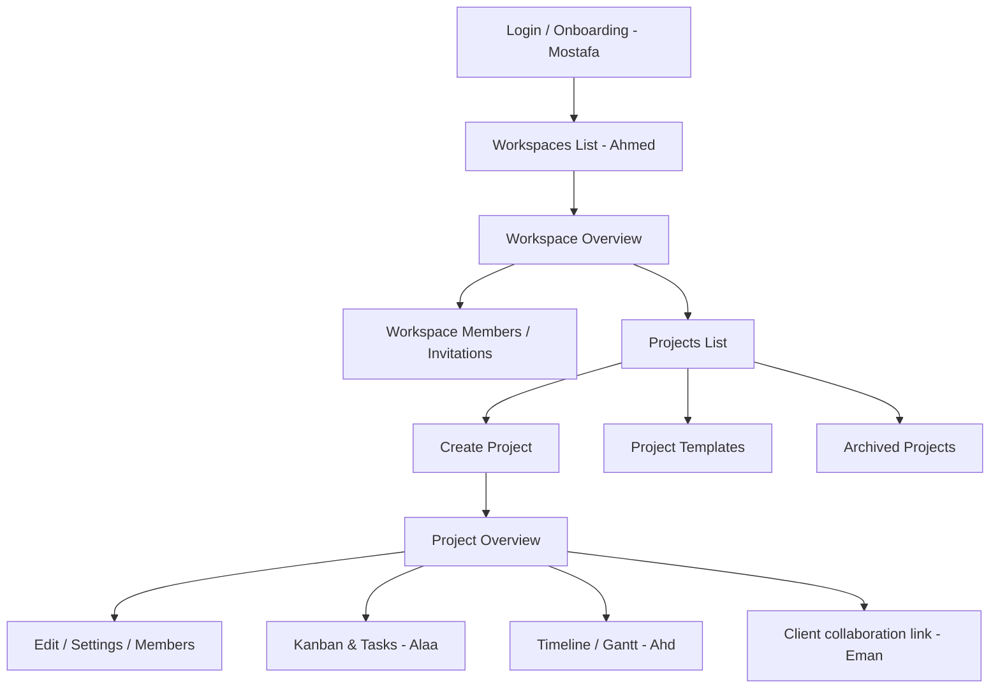

# TaskFlow — أحمد رضا أحمد صديق | Workspaces & Projects

> **ابدأ من هنا.** ده تسليم مهام أحمد بالكامل: **14 شاشة/واجهة** لإدارة مساحات العمل والمشروعات؛ لكل شاشة **برومبت تصميم UI مستقل** و**برومبت تنفيذ Frontend مستقل**. كل الملفات بصيغة Markdown (`.md`) وتقدر تفتحها على GitHub أو VS Code.

## 1. أحمد مسؤول عن إيه بالظبط؟

أحمد مسؤول عن **Workspaces & Projects Management** بعد تسجيل المستخدم ودخوله. بيبني تجربة الانتقال بين مساحات العمل، صفحة تفاصيل كل Workspace، الأعضاء والدعوات، قائمة المشروعات، إنشاء وتعديل المشروع، القوالب والأرشيف والصلاحيات المرتبطة بالأجزاء دي. لازم كل شاشة تتكامل مع الـApp Shell والـDesign System ومكونات الفورمز اللي مصطفى جهزها، من غير ما يبدأ مشروع جديد أو يكرر كود الفريق.

**خارج نطاق أحمد:** Authentication، أول Workspace داخل Onboarding (مصطفى)، Tasks/Kanban وتفاصيل المهمة (آلاء)، Timer/Calendar/Gantt/Reports (عهد)، Clients/Client Portal/Deliverables (إيمان). أحمد يعمل روابط تكامل واضحة، مش إعادة تنفيذ موديولاتهم.

## 2. العدد النهائي

- **14 شاشة وظيفية**: 6 Workspaces + 8 Projects.
- **14 ملف UI design prompt** داخل `01-UI-Design-Prompts/`.
- **14 ملف Frontend implementation prompt** داخل `02-Frontend-Implementation-Prompts/`.
- **28 برومبت منفصل بالضبط**، وده غير README الرئيسي وخرائط التنظيم.
- **مش شرط 14 صفحة HTML منفصلة في النسخة النهائية**: Create/Edit Project أو Invite Member أو Role Dialog ممكن تتحول إلى Drawer/Modal حسب أسلوب المشروع، بشرط كل وظيفة وتفاعل يفضلوا متنفذين، وتوثيق مكان الملفات النهائي. المسارات الواردة هي الـReference contract لتجنب التشتت.

## 3. خريطة الشاشات والبرومبتات

| # | الشاشة | HTML بالنسبة إلى `frontend/pages/app/` | ملف التصميم | ملف التنفيذ |
|---|---|---|---|---|
| 01 | Workspaces List | `workspaces/index.html` | `01-UI-Design-Prompts/01-workspaces-list-UI-README.md` | `02-Frontend-Implementation-Prompts/01-workspaces-list-FRONTEND-README.md` |
| 02 | Workspace Overview | `workspaces/overview.html` | `01-UI-Design-Prompts/02-workspace-overview-UI-README.md` | `02-Frontend-Implementation-Prompts/02-workspace-overview-FRONTEND-README.md` |
| 03 | Create Workspace | `workspaces/create.html` | `01-UI-Design-Prompts/03-create-workspace-UI-README.md` | `02-Frontend-Implementation-Prompts/03-create-workspace-FRONTEND-README.md` |
| 04 | Workspace Settings | `workspaces/settings.html` | `01-UI-Design-Prompts/04-workspace-settings-UI-README.md` | `02-Frontend-Implementation-Prompts/04-workspace-settings-FRONTEND-README.md` |
| 05 | Workspace Members | `workspaces/members.html` | `01-UI-Design-Prompts/05-workspace-members-UI-README.md` | `02-Frontend-Implementation-Prompts/05-workspace-members-FRONTEND-README.md` |
| 06 | Workspace Invitations | `workspaces/invitations.html` | `01-UI-Design-Prompts/06-workspace-invitations-UI-README.md` | `02-Frontend-Implementation-Prompts/06-workspace-invitations-FRONTEND-README.md` |
| 07 | Projects List | `projects/index.html` | `01-UI-Design-Prompts/07-projects-list-UI-README.md` | `02-Frontend-Implementation-Prompts/07-projects-list-FRONTEND-README.md` |
| 08 | Create Project | `projects/create.html` | `01-UI-Design-Prompts/08-create-project-UI-README.md` | `02-Frontend-Implementation-Prompts/08-create-project-FRONTEND-README.md` |
| 09 | Project Overview | `projects/overview.html` | `01-UI-Design-Prompts/09-project-overview-UI-README.md` | `02-Frontend-Implementation-Prompts/09-project-overview-FRONTEND-README.md` |
| 10 | Edit Project | `projects/edit.html` | `01-UI-Design-Prompts/10-edit-project-UI-README.md` | `02-Frontend-Implementation-Prompts/10-edit-project-FRONTEND-README.md` |
| 11 | Project Settings | `projects/settings.html` | `01-UI-Design-Prompts/11-project-settings-UI-README.md` | `02-Frontend-Implementation-Prompts/11-project-settings-FRONTEND-README.md` |
| 12 | Project Members | `projects/members.html` | `01-UI-Design-Prompts/12-project-members-UI-README.md` | `02-Frontend-Implementation-Prompts/12-project-members-FRONTEND-README.md` |
| 13 | Project Templates | `projects/templates.html` | `01-UI-Design-Prompts/13-project-templates-UI-README.md` | `02-Frontend-Implementation-Prompts/13-project-templates-FRONTEND-README.md` |
| 14 | Archived Projects | `projects/archived.html` | `01-UI-Design-Prompts/14-archived-projects-UI-README.md` | `02-Frontend-Implementation-Prompts/14-archived-projects-FRONTEND-README.md` |

## 4. طريقة الشغل خطوة بخطوة

1. افتح ملفات المشروع الحالي اللي فيه Public + Auth + Onboarding. لا تبدأ Project جديد.
2. استلم **اللوجو الأصلي** ولوحة الألوان وصور التصميمات المعتمدة للـShared App Shell. غير مسموح استخدام Emojis في الواجهة.
3. افتح برومبت التصميم `01-...-UI-README.md` للشاشة المطلوبة، وارفق صور TaskFlow الأصلية. اطلب صورة واحدة عالية الجودة للشاشة نفسها.
4. بعد اعتماد الصورة، افتح برومبت التنفيذ المقابل `02-...-FRONTEND-README.md` وارفق **المشروع الحالي + الصورة الخاصة بالشاشة**. اطلب التنفيذ في مسارات الصفحة المحددة، ثم اختبارها.
5. اعتمد مراجعة Visual Screenshot وقارن الـBrowser بالشكل النهائي؛ اعمل Responsive، Validation، Empty/Loading/Error states.
6. نفّذ الشاشات بالترتيب: Workspaces List → Workspace Overview → Create → Settings → Members → Invitations → Projects List → Create → Overview → Edit → Settings → Members → Templates → Archived.
7. شغّل Regression Test بعد كل شاشة: الصفحات القديمة شغالة والـRoutes والـAssets سليمة.

## 5. Workflow الأساسي

## 6. الأدوار والصلاحيات

**Owner / Admin / Member / Viewer** هي أدوار داخل Workspace. مالك الـWorkspace هو اللي أنشأه. Client الخارجي مش عضو داخلي تلقائيًا.

- Owner: ملكية مساحة العمل والإجراءات الحساسة وفق القواعد النهائية للفريق.
- Admin: إدارة الأعضاء والإعدادات حسب الـPermission Matrix المعتمدة.
- Member: التعاون والمشاركة في المشروعات المسموح بها؛ أي صلاحية إنشاء/تعديل يجب تعريفها بوضوح.
- Viewer: قراءة المحتوى المسموح فقط، بدون صلاحيات تعديل.
- لا يجوز للمستخدم تغيير Role نفسه أو ترقية نفسه؛ Role الدعوة يحددها الداعي؛ ممنوع حذف آخر Owner بطريقة عادية.
- **Frontend role checks مجرد Demo/UI affordances** وليست بديلًا عن Backend authorization.

## 7. القواعد البصرية والتقنية الثابتة

- Dark Forest: `#0D2C26` (sidebar/brand depth)
- Forest: `#123B31` (headings, deep surfaces)
- Olive: `#2E7D32` (primary actions)
- Sage: `#4CAF7B` (focus/selection/success)
- Warm Beige: `#F5EFE6` (background)
- Off-white: `#FCFAF6` (surfaces)
- Terracotta: `#C96F4A` (restrained highlights)
- Charcoal: `#1F2937` (main text)
- Slate: `#64748B` (muted text)
- Font: **Inter**; line icons SVG, no emoji anywhere in UI.

HTML5 + CSS3 + Vanilla JS ES6 Modules فقط. مفيش React/Vite. Sidebar أخضر داكن، خلفيات Off-white وWarm Beige، خط Inter، أيقونات SVG موحدة. الـPublic Navbar الزجاجي يخص صفحات Public، مش Dashboard. الـForms والButtons والتوست والModal مشتركة من مصطفى.

**كود واضح مش سباجتي:** indentation ثابت، كل CSS declaration بسطر، كل HTML element بسطور منظمة، JS functions صغيرة وdescriptive، فصل منطق الصفحة عن data service، عدم كتابة كل الصفحة أو ملفات JS في سطر واحد، عدم إنشاء فواصل/ملفات بلا سبب، عدم وجود أزرار غير شغالة.

## 8. حدود الـDemo والبيانات

لو لسه مفيش Backend، يشتغل بـMock Data متسقة بين كل الشاشات (workspaceId/projectId)، من غير ادعاء إرسال دعوات حقيقية أو حماية صلاحيات حقيقية. Progress وعدد المشروعات والأعضاء لازم يطلعوا من نفس الـMock Source؛ مينفعش الأرقام تتناقض بين Overview والقوائم. استخدم `textContent` للبيانات اللي بيدخلها المستخدم.

## 9. قواعد التكامل المهمة

- **إنشاء أول Workspace أثناء Onboarding** ملك مصطفى؛ شاشة أحمد `workspaces/create.html` لإنشاء Workspace إضافية **بعد الدخول**.
- **Manage Workspace Invitations** ملك أحمد؛ شاشة **Accept Team Invitation** ملك مصطفى.
- **Project Overview** ملك أحمد؛ تفاصيل Tasks/Kanban تابعة لآلاء، والتايملاين والتقارير تابعة لعهد.
- **Client Portal and Client Access** ملك إيمان، أحمد ما يديش Client صلاحيات Workspace داخلية.
- لو Page designs بتعرض `Developer` أو `Designer` في مكان Role، دي Job Titles وليست Authorization Roles. استخدم Admin/Member/Viewer.
- Type = Personal / Freelancer / Team / Company **مش اشتراك مدفوع**.

## 10. التسليم النهائي المطلوب من أحمد

1. كل الشاشات الـ14 أو بدائلها المنطقية الموثقة (Pages/Drawers/Modals) شغالة.
2. Screenshots مرجعية مع مقارنة التنفيذ، وتصحيح الاختلافات البصرية.
3. Navigation حقيقي بين أجزاء أحمد، وروابط تكامل واضحة لباقي الفريق.
4. Forms validations, loading, empty, error, success, permission states.
5. File Structure متسق، CSS components مشتركة، JS modules/Mock services مفهومة.
6. اختبارات Responsive: 1440 / 1024 / 768 / 390 / 360px.
7. README محدث يوضح الملفات المتغيرة وطريقة التشغيل وحدود الـMock والـBackend integration.

**نقطة أخيرة:** الملفات دي Prompts ومواصفات للتصميم والتنفيذ، مش كود Frontend جاهز ولا صور UI جاهزة. الصور الناتجة من برومبتات التصميم تبقى References لملفات التنفيذ المقابلة.
